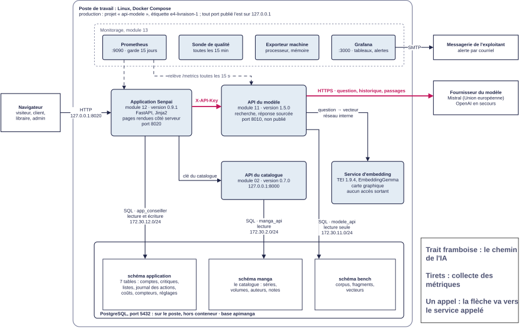
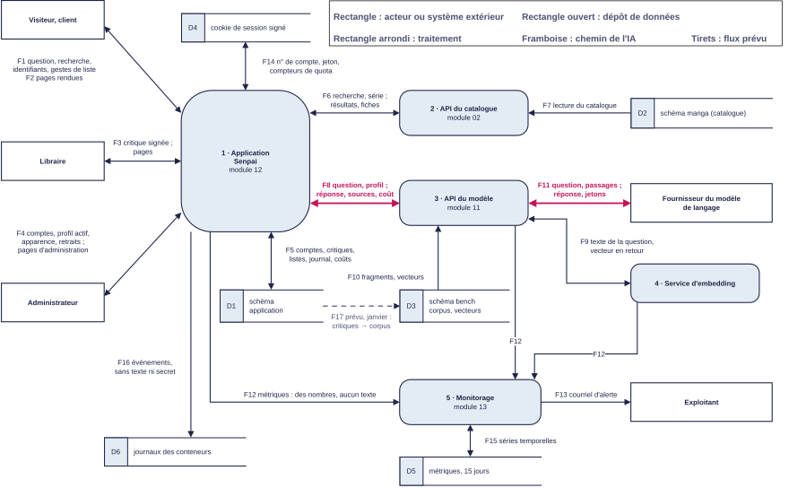
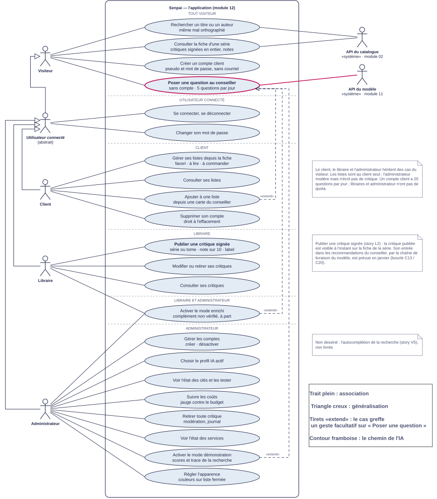
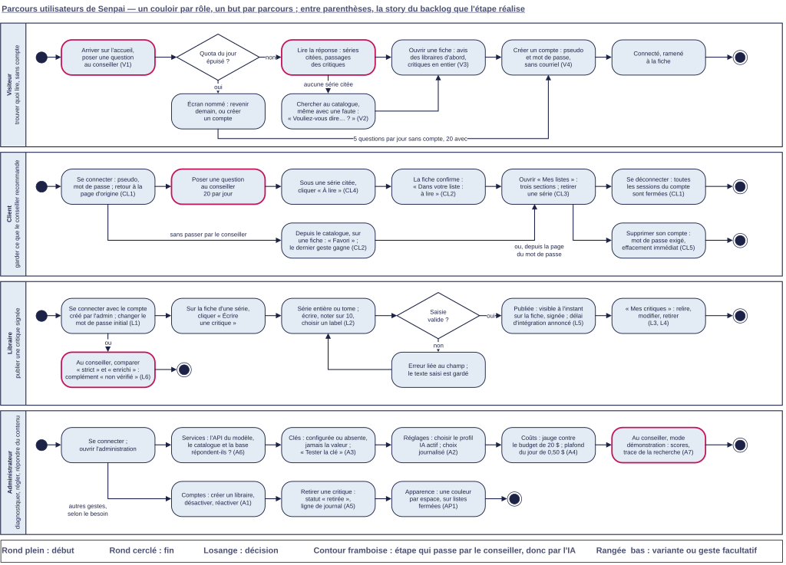

# Schémas de conception — épreuve E4

Quatre schémas de l'application Senpai et des services qui l'entourent, dessinés avec
draw.io. Ils décrivent la livraison `e4-livraison-1` (2026-11-11) : application 0.9.1,
API du modèle 1.5.0, API du catalogue 0.7.0. Les versions ont avancé depuis (étiquette
`e5-incident` : application 0.9.2, API du catalogue 0.7.2) ; les schémas restent ceux de
la livraison E4.

| Schéma | Ce qu'il montre |
|---|---|
| [1 · Architecture technique](#1--architecture-technique) | Les services du poste, leurs ports, leurs rôles en base et leurs sous-réseaux ; le monitorage ; les deux services extérieurs (fournisseur du modèle, messagerie de l'exploitant). |
| [2 · Flux de données](#2--flux-de-données) | Ce qui circule entre les acteurs, l'application, les deux API, le service d'embedding et le monitorage : cinq traitements, six dépôts (D1 à D6), dix-sept flux (F1 à F17). |
| [3 · Cas d'utilisation](#3--cas-dutilisation) | Les cas de l'application par rôle (visiteur, utilisateur connecté, client, libraire, administrateur), la généralisation des acteurs et trois « extend » sur « Poser une question au conseiller ». |
| [4 · Parcours utilisateurs](#4--parcours-utilisateurs) | Un couloir par rôle et un but par parcours ; chaque étape renvoie à la story du backlog qu'elle réalise (V1, CL2, L2, A7…). |

Sur les quatre schémas, le trait ou le contour framboise marque le chemin de l'IA : ce
qui passe par le conseiller, donc par l'API du modèle et son fournisseur.

## 1 · Architecture technique



## 2 · Flux de données

Le flux F17 (les critiques des libraires versées au corpus) est prévu en janvier :
il est dessiné en tirets.



## 3 · Cas d'utilisation



## 4 · Parcours utilisateurs



## Les fichiers

| Fichier | Contenu |
|---|---|
| `schemas_conception_e4.pdf` | Les quatre schémas, une page chacun, tels qu'exportés de draw.io. Ses métadonnées portent aussi le source draw.io des quatre pages. |
| `01_…svg` à `04_…svg` | Une page du PDF chacun, convertie en SVG. Le texte y est tracé en contours : l'affichage ne dépend d'aucune police, mais le SVG ne s'édite pas. Un fond blanc est ajouté pour la lecture en thème sombre. |

## Mettre à jour

On modifie le schéma dans draw.io, on réexporte le PDF sous le même nom, puis on
régénère les SVG depuis ce dossier (`pdftocairo` vient de `poppler-utils`) :

```bash
n=1
for nom in 01_architecture_technique 02_flux_de_donnees 03_cas_d_utilisation 04_parcours_utilisateurs; do
  pdftocairo -svg -f $n -l $n schemas_conception_e4.pdf $nom.svg
  sed -i '0,/<svg[^>]*>/s//&\n<rect width="100%" height="100%" fill="#ffffff"\/>/' $nom.svg
  n=$((n+1))
done
```
