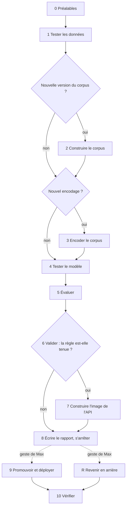

# La chaîne de livraison du modèle (module 14)

La chaîne enchaîne, en une commande, les gestes qui existent déjà un par un dans les
modules 05, 09, 10 et 11 : tester les données, encoder le corpus, tester l'encodage,
mesurer, appliquer la règle de promotion, construire l'image de l'API. Elle tourne en
préproduction, sur une copie de la base, et ne touche jamais la production. Elle s'arrête
**avant** la promotion, avec un rapport de livraison versionné : un humain décide.

- **Le modèle qu'elle porte** : le modèle d'embedding, celui qui transforme les textes du
  corpus en vecteurs. Un nouvel encodage du corpus, c'est l'« entraînement » de ce projet.
  Le modèle de langage n'est pas livré par la chaîne : c'est une dépendance surveillée.
- **Ce qu'elle ne fait jamais** : promouvoir un encodage, ni viser la base de production.
  La promotion et le retour arrière sont des gestes de Max, en préproduction.

## Le vocabulaire

| Mot | Ce qu'il veut dire ici |
|---|---|
| corpus | l'ensemble des textes (critiques, synopsis, résumés) découpés en fragments, dans la base ; il a des versions (v1, v2) |
| encodage | les vecteurs de tous les fragments d'un corpus, calculés par un modèle d'embedding ; chaque encodage a un numéro |
| instance | le service d'embedding qui tourne sur la carte graphique, pour un modèle (EmbeddingGemma, BGE-M3) |
| préproduction | une copie de la base de production, sur le même serveur, où la chaîne a le droit d'écrire |
| promotion, retour arrière | une ligne au journal des promotions, qui choisit l'encodage en service ; jamais d'effacement |
| run MLflow | une mesure enregistrée dans MLflow, l'outil qui garde les paramètres et les chiffres de chaque mesure |
| image, empreinte | l'image Docker de l'API (ce qui se lance dans un conteneur) et son identifiant unique (`sha256:…`) |
| Docker Compose | l'outil qui décrit et lance plusieurs conteneurs ensemble, à partir d'un fichier |
| candidat | un fichier qui dit ce que la chaîne doit juger : un corpus, un encodage, une mesure, une règle |
| jeu d'évaluation gelé | les 69 questions de référence, avec leurs réponses attendues ; il ne change plus |
| test d'équivalence, cosinus minimal | on réencode 200 fragments et on compare aux vecteurs en base ; le cosinus minimal est l'accord le plus faible (1 = identique) |
| reconnaissance, proposition, nDCG@10 | deux familles de questions du jeu (retrouver une œuvre décrite, proposer des œuvres) et une mesure de la qualité du classement des 10 premiers |
| rejeu, run de référence | rejouer une mesure et la comparer, chiffre par chiffre, à un run déjà enregistré |
| sonde, pile du monitorage | la pile lance l'API, l'application et le monitorage ; la sonde y vérifie l'équivalence toutes les 15 minutes |
| E3, E4 | deux épreuves de la certification ; la chaîne a été construite à l'étape 6 d'E3 (à ne pas confondre avec l'étape 6 de la chaîne, « Valider ») |

## Les trois environnements

Un environnement, c'est une base et les fichiers qui vont avec.

| Environnement | Où | Sert à | La chaîne y écrit |
|---|---|---|---|
| développement | bases jetables des tests (`make verify`) | les tests de tous les modules | non : les tests de la chaîne tournent avec des étapes factices, sans base |
| préproduction | la base `apimanga_preprod`, copie de la production sur le même serveur, et le dossier `09_service_embedding/mesures/equivalence_preprod/` | les passages réels de la chaîne, les promotions, les retours arrière | oui |
| production | la base `apimanga` et le dossier `09_service_embedding/mesures/equivalence/` | l'API et l'application en service | **jamais** : elle n'est que lue |

**On ne touche jamais la production.** On n'y fait aucun essai. La chaîne ne vise que
`apimanga_preprod` : toute autre base, la production comprise, est refusée (code 20 ; la
base se règle par la variable `CHAINE_BASE`). Elle refuse aussi de démarrer sans la variable
du dossier de la préproduction, ou avec le dossier de la production. Une mise en production
future suivra une [procédure écrite à part](#mettre-en-production-un-futur-candidat).

**La préproduction a sa base et ses propres fichiers.** Un passage de préproduction écrit
ses échantillons d'équivalence dans le dossier de la préproduction, et construit l'image de
l'API sous son propre nom (`api-modele:<version>-preprod`). Il n'écrit jamais dans le
dossier que lisent la sonde du monitorage et `make verify-poste`, et ne touche jamais
l'image de la production.

## Les étapes

Une étape est un geste de la chaîne. Les étapes 0 à 8 tournent d'un trait, dans cet
ordre ; la chaîne s'arrête à la première qui échoue, et écrit quand même son rapport.



La même suite, en texte : 0, les préalables ; 1, tester les données ; 2, construire le
corpus, seulement si le candidat déclare une nouvelle version ; 3, encoder, seulement s'il
demande un nouvel encodage ; 4, tester le modèle ; 5, évaluer ; 6, valider par la règle ;
7, construire l'image de l'API, seulement si la règle est tenue ; 8, écrire le rapport et
s'arrêter. Ensuite, deux gestes de Max, hors de la chaîne : 9, promouvoir puis déployer,
et R, revenir en arrière ; chacun est suivi de 10, vérifier.

| N° | Étape | Tâche | Commande appelée | S'exécute si | Code d'arrêt | Produit |
|---|---|---|---|---|---|---|
| 0 | Préalables | cible = préproduction ; dossier d'export de la préproduction ; arbre propre et poussé ; candidat commité et conforme ; pile du monitorage arrêtée ; instance d'embedding en marche, `/info` conforme ; état de départ de la préproduction | git, docker, `/info`, psql | toujours | 20, 21 | — |
| 1 | Tester les données | jeu d'évaluation gelé ; empreintes du corpus ; corpus reconstruit à blanc contre sa règle, pseudonymes compris | `corpus.construire_v2 --dry-run` (05) | toujours | 30 | lignes du rapport |
| 2 | Construire | la nouvelle version du corpus | `corpus.construire_v2` (05) | le candidat déclare une nouvelle version | 40 | la version du corpus |
| 3 | Encoder | un nouvel encodage du corpus, sur la carte graphique | `service_embedding.encodage` (09) | le candidat demande un nouvel encodage | 50 | un encodage inscrit, non promu |
| 4 | Tester le modèle | échantillon exporté dans le dossier de la préproduction, puis test d'équivalence | `service_embedding.equivalence exporter`, `comparer` (09) | toujours | 60 | le cosinus minimal, un verdict |
| 5 | Évaluer | mesure sur le jeu gelé ; rejeu d'une référence si le candidat en déclare une | `mesures_recherche.executer` (10) | toujours | 70 | un run MLflow, une ligne `eval_runs`, des `eval_mesures` (préproduction) |
| 6 | Valider | la règle de promotion, commitée avant la mesure | `mesures_recherche.promotion` (10) | toujours | 10, 11 | un verdict |
| 7 | Packaging | l'image de l'API de préproduction (`api-modele:<version>-preprod`), construite au commit ; son empreinte ; ce qui sort du cache | `docker compose build api` (11, avec `compose.preprod.yml`) | verdict « promotion proposée » | 80 | l'empreinte de l'image |
| 8 | Rapport et arrêt | le rapport de livraison, attaché au run MLflow ; la chaîne s'arrête là | `mlflow artifacts log-artifact` (10) | toujours, même après un arrêt | — | le rapport `.md` et `.json`, un code de sortie |
| 9 | Déployer (Max) | la promotion au journal de la préproduction ; l'API de préproduction levée ; `/v1/info` désigne l'encodage promu | `journal_promotions promouvoir` (10) ; Compose du 11 | geste de Max, sur « promotion proposée » | 20, 80 | une ligne au journal ; l'API vérifiée |
| 10 | Vérifier | encodage 3 : équivalence de l'API, 69 questions sur 69 ; encodage 2 : la mesure 8 rejouée, 104 métriques sur 104 | `tests/test_egalite_banc.py` (11) ; `mesures_recherche.executer --rejeu-de` (10) | après 9 et après R | 70 | le résultat, au journal d'exécution |
| R | Revenir (Max) | le retour arrière au journal de la préproduction ; l'API levée ; la vérification | `journal_promotions revenir` (10) | geste de Max | 20, 70, 80 | une ligne au journal ; la vérification |

Aucune logique des modules appelés n'est recopiée : chaque étape lance leur commande, dans
leur environnement (`uv run` dans le module), et lit leur sortie.

## Les déclencheurs

Un déclencheur est ce qui lance quelque chose : un geste, un événement, une heure. Ils ont
été définis et datés le 7 novembre 2026, avant le code ; un test de ce module vérifie que ce
tableau dit vrai.

| N° | Déclencheur | Où il est configuré | Ce qu'il lance | Ce qu'il produit |
|---|---|---|---|---|
| 1 | chaque commit | `.githooks/pre-commit` | mentions interdites, fichiers exclus, clés et jetons | le commit, ou un refus |
| 2 | chaque push | `.githooks/pre-push` | auteur et validateur, mentions, fichiers interdits, clés, noms des branches et des étiquettes | le push, ou un refus |
| 3 | une demande de fusion (ouverte, mise à jour, rouverte, modifiée) | `verify.yml` (`pull_request`) | `perimetre`, une tâche `verify <module>` par module concerné, `statique` | les contrôles obligatoires ; fusion bloquée si l'un est rouge |
| 4 | un push sur `develop` | `verify.yml` (`push`, `develop`) | les mêmes tâches | le statut de `develop` |
| 5 | à la main, sur GitHub | `verify.yml` (`workflow_dispatch`), `indicatif.yml` (`workflow_dispatch`) | les mêmes tâches, ou Bandit et pip-audit | un statut |
| 6 | chaque lundi, à 06:00 UTC | `indicatif.yml` (`schedule`, `0 6 * * 1`) | Bandit et pip-audit sur tous les modules | des rapports indicatifs |
| 7 | à la main, sur le poste | `Makefile` (`preprod-creer`) | la copie de la production vers `apimanga_preprod`, et ses contrôles | la préproduction, prête ou recréée |
| 8 | à la main, sur le poste, quand une règle de corpus ou une configuration du modèle change | `Makefile` (`chaine`), `14_chaine/candidats/*.toml` | les étapes 0 à 8, en préproduction | un rapport de livraison, un run MLflow, une ligne `eval_runs` de préproduction, un code de sortie ; jamais de promotion |
| 9 | Max : la promotion | `Makefile` (`chaine-promouvoir`) | les étapes 9 et 10 | une ligne au journal de la préproduction ; l'API vérifiée |
| 10 | Max : le retour arrière | `Makefile` (`chaine-revenir`) | l'étape R | une ligne au journal de la préproduction ; la vérification |
| 11 | à la main, avant une demande vers `main` | `Makefile` (`verify-poste`, `verify-mutations`) | l'état de la production (en lecture seule), les équivalences, les pseudonymes, les mutations | un feu vert, ou un arrêt |

**Ce qui n'est pas un déclencheur, mais peut motiver le 8** : une alerte du monitorage
(l'équivalence du service d'embedding, des sorties refusées), une règle de corpus modifiée,
un modèle à essayer. C'est la boucle de retour : le monitorage signale, un humain lance la
chaîne. Le déclenchement est manuel par choix : un déclencheur planifié réencoderait un
corpus qui n'a pas bougé, et un exécuteur GitHub sur le poste ferait tourner du code
extérieur, le dépôt étant public.

Les deux passages de l'étape 6 d'E3 sont lancés pour démontrer la chaîne, pas parce qu'une
règle a changé.

## Installation

1. **Les outils** : `uv`, Docker avec Docker Compose, la carte graphique et son pilote (le
   service d'embedding tourne dessus), le client PostgreSQL (`psql`, `pg_dump`,
   `pg_restore`, `createdb`, `dropdb`).
2. **L'environnement du module** : `cd 14_chaine && uv sync --locked --extra dev`. La
   chaîne n'a aucune dépendance à l'exécution : la bibliothèque standard de Python suffit.
3. **Les mots de passe**, dans `~/.pgpass`. Un mot de passe appartient au rôle, pas à la
   base : chaque ligne nouvelle copie la ligne `apimanga` du même rôle — même hôte et même
   port que cette ligne —, et seul le nom de la base change. La chaîne vérifie ces lignes
   par une connexion ; elle n'ouvre jamais le fichier. Leur forme, sans le mot de passe,
   `<hôte>:<port>` étant ceux de la ligne `apimanga` du rôle :

   ```text
   <hôte>:<port>:apimanga_preprod:postgres:<mot de passe du rôle postgres>
   <hôte>:<port>:apimanga_preprod:verif_lecture:<mot de passe du rôle verif_lecture>
   <hôte>:<port>:apimanga_preprod:modele_api:<mot de passe du rôle modele_api>
   <hôte>:<port>:postgres:postgres:<mot de passe du rôle postgres>
   ```

   La dernière ligne ouvre la base d'entretien du serveur, celle où l'on se connecte pour
   créer ou supprimer une base.
4. **Le fichier de mots de passe du conteneur de l'API de préproduction** : une copie à
   part de celui de l'API de production, où seul le nom de la base change
   (`host.docker.internal:5432:apimanga_preprod:modele_api:<mot de passe>`). Son chemin se
   donne par la variable `PREPROD_PGPASS_CONTENEUR`, jamais dans le dépôt. Le serveur
   PostgreSQL doit admettre `modele_api` dans `apimanga_preprod` depuis le réseau de l'API
   (`172.30.11.0/24`) : une ligne de `pg_hba.conf` (le fichier du serveur qui dit qui peut
   se connecter, à quelle base, d'où), au modèle de celle d'`apimanga`
   (`host  apimanga_preprod  modele_api  172.30.11.0/24  scram-sha-256`), puis un
   rechargement du serveur.
5. **Le dossier d'export de la préproduction** : `make` le donne lui-même, par la variable
   `EQUIVALENCE_DOSSIER` (`09_service_embedding/mesures/equivalence_preprod/`, ignoré par
   git). La chaîne refuse de démarrer sans lui, ou avec le dossier de la production.
6. **La préproduction** : `make preprod-creer`. La commande copie `apimanga` dans
   `apimanga_preprod` (`pg_dump` puis `pg_restore`, sous `postgres`), puis contrôle la copie
   et la production contre `verification/etat_apimanga.tsv` : les empreintes des corpus, des
   vecteurs et des mesures ; le nombre de lignes du journal des promotions et d'`eval_runs` ;
   l'encodage en service ; le nombre de migrations. Le 7 novembre 2026, la copie a pris
   186,9 s pour 2 011 Mo. Si la préproduction existe, elle
   est supprimée et recréée : c'est une réinstallation de l'environnement. Aucun autre nom
   de base n'est admis.
7. **L'image de l'API de préproduction** : la chaîne la construit sous le nom
   `api-modele:<version>-preprod` (la version est lue dans le Compose du module 11), grâce à
   `14_chaine/compose.preprod.yml`, posé sur ce Compose. L'image de la production garde son
   nom et n'est jamais reconstruite par la chaîne. Cette image est un préalable de la
   promotion et du retour arrière : sur un poste neuf, un premier passage jusqu'à l'étape 7
   la construit (sinon, les deux gestes refusent, sans rien écrire). Chaque passage qui
   arrive à l'étape 7 la reconstruit : seul le rapport du dernier passage peut être promu.

## Configuration : le fichier de candidat

Un candidat est un fichier TOML (un format de configuration lisible) de
`14_chaine/candidats/`. Il dit ce que la chaîne doit
juger. Son schéma est fermé : une clé inconnue, une clé manquante ou un type faux arrête
la chaîne (code 21). Il doit être commité et identique à `HEAD` (sinon, code 20).

| Clé | Type | Sens |
|---|---|---|
| `nom` | texte | le nom du candidat, égal au nom du fichier |
| `motif` | texte | pourquoi on le lance |
| `[corpus] version` | texte | la version du corpus jugée (`v2`) |
| `[corpus] nouvelle_version` | booléen | `true` : l'étape 2 construit cette version |
| `[encodage] nouveau` | booléen | `true` : l'étape 3 encode ; `false` : un encodage existant est réutilisé |
| `[encodage] instance` | texte | l'instance du service d'embedding (`bge-m3`, `embeddinggemma`) |
| `[encodage] numero` | entier | l'encodage existant (seulement si `nouveau = false`) |
| `[encodage] modele`, `revision`, `precision` | texte | ce que l'instance doit servir (seulement si `nouveau = true`) |
| `[mesure] numero` | entier | le numéro de la configuration dans `10_mesures_recherche/config/mesures.toml` |
| `[mesure] reference_run` | texte, facultatif | un run MLflow que la mesure doit reproduire à l'identique |
| `[regle] fichier` | texte | la règle, le fichier unique du module 10 |
| `[preproduction] encodage_en_service` | entier | l'encodage que la préproduction doit servir au départ |

**La règle** est `10_mesures_recherche/config/promotion_corpus_v2.toml`, commitée le
10 octobre 2026 (commit `b6c081c`), avant toute mesure de la chaîne : au moins 31 questions
sur 59 au global et 20 sur 23 en reconnaissance. Le seuil de 31 est le score de la
référence : aucune perte nette n'est admise au global. En reconnaissance, la référence fait
21 sur 23 et le seuil est de 20 : une question de marge, parce qu'une question seule ne
prouve rien. La règle et les résultats comptent sur 59 questions, et non sur les 69 du jeu :
les 10 autres n'attendent aucune série du catalogue — 5 questions de refus sur des œuvres
inventées et 5 œuvres reconnues mais hors catalogue — ; elles jugent le modèle de langage,
qui doit refuser, pas le classement (d'où aussi 23 questions de reconnaissance, et non 28).
Elle ne juge que le corpus v2, et jamais
l'encodage en service. Elle est réutilisée telle quelle : aucune règle
n'a été écrite pour la chaîne.

**Les deux candidats réels** (faits pendant l'étape 6 d'E3) :

| Candidat | Ce qu'il fait | Attendu |
|---|---|---|
| `refus_bgem3_v2` | encode le corpus v2 avec BGE-M3, l'autre modèle du banc, et le mesure (configuration 7) | un refus (code 10) : sur le corpus v1, ce modèle rendait 22 sur 59 et 16 sur 23 |
| `requalification_v2` | réutilise l'encodage 3, retiré du service en préproduction, et rejoue sa mesure (configuration 8) | une promotion proposée (code 0) : 31 sur 59, 21 sur 23, identique au run de référence |

## Tester la chaîne

- **Les tests** : `make verify MODULE=14`. Ils tournent avec des étapes factices : aucun
  service, aucune base. Ils prouvent l'ordre des étapes, l'arrêt au premier échec, les
  refus, le refus de la production, que `lancer` ne promeut jamais, et la lecture des
  vraies sorties des modules (dossier `tests/sorties_reelles/`).
- **Le passage à blanc** : `make chaine CANDIDAT=14_chaine/candidats/refus_bgem3_v2.toml A_BLANC=1`.
  Il affiche les commandes, leurs arguments, la base visée et ce que chaque commande
  écrirait, sans rien lancer.
- **Sur GitHub** : la tâche `verify 14` joue les mêmes tests, avec Ruff (le style), Pyright
  (les types), Bandit (la sécurité du code) et pip-audit (les failles connues des
  dépendances). Elle tourne à chaque demande de fusion qui touche la chaîne, un module dont
  elle lance les commandes (05, 09, 10, 11) ou un fichier commun (`verification/`, le
  `Makefile`, les workflows) ; c'est le déclencheur 3.

## Lancer un passage et lire le rapport

```bash
make chaine CANDIDAT=14_chaine/candidats/requalification_v2.toml A_BLANC=1   # à blanc
make chaine CANDIDAT=14_chaine/candidats/requalification_v2.toml             # le passage
```

- Le passage se lance depuis la racine du dépôt. La pile du monitorage est arrêtée
  (`make monitorage-arret`). L'instance du service d'embedding du candidat tourne :
  `docker compose --profile <profil> up -d` dans `09_service_embedding/`, avec le profil de
  l'instance du candidat (`[encodage] instance`) — `embeddinggemma`, ou `bge-m3` pour
  BGE-M3.
- **Rejouer un candidat** demande son état de départ. La requalification attend l'encodage 2
  en service : après la promotion du 7 novembre, il faut d'abord un retour arrière. Le refus
  de BGE-M3, rejoué tel quel, s'arrêterait au code 50 : son encodage existe déjà. Pour
  repartir de zéro : `make preprod-creer`, qui recrée la préproduction.
- Il écrit son rapport dans `14_chaine/livraisons/` : un `.md` pour un humain, un `.json`
  pour la commande de promotion. **Un passage = un rapport commité** avant le suivant : la
  chaîne refuse un arbre qui n'est pas propre.
- Le `.md` se lit. Les nombres sont à la française : quatre décimales pour les mesures,
  huit pour le cosinus minimal, une pour les durées, la mémoire en Go. La reconnaissance et
  la proposition ont leur dénominateur. Chaque étape de 0 à 7 a sa ligne ; une étape « non
  lancée » dit pourquoi. Le motif d'un arrêt reste un texte libre : seuls ses réels longs et
  ses dictionnaires y sont réécrits. Le `.json` garde les valeurs brutes.
- Si la chaîne s'arrête en erreur, `make` affiche « Erreur N » et sort avec le statut 2 :
  le code de la chaîne est N, et se lit aussi dans sa ligne « Code de sortie ». Un geste de
  Max ou un passage à blanc refusés affichent « Refus — code N ».

### Lire un rapport : l'exemple réel de la requalification

Le [rapport de livraison de la requalification, le 7 novembre 2026](livraisons/20261107T121319Z_requalification_v2.md)
(code 0), champ par champ :

| Champ | Valeur réelle | Ce qu'il dit |
|---|---|---|
| Code de sortie | 0 (`PROMOTION_PROPOSEE`) | toutes les étapes ont tenu, la règle aussi ; la chaîne s'est arrêtée avant la promotion |
| Environnement | préproduction, base `apimanga_preprod` | la base visée ; jamais la production |
| Dossier des échantillons | `09_service_embedding/mesures/equivalence_preprod` | où l'échantillon d'équivalence a été écrit |
| Candidat | `14_chaine/candidats/requalification_v2.toml` et son motif | ce qui a été jugé, et pourquoi |
| Commit | `597146c…` | l'état exact du code et du candidat |
| Corpus, encodage | v2, encodage 3 | la version du corpus et l'encodage jugés |
| Mesure | configuration 8, run MLflow `2516e8fa…` (expérience `E3-chaine-preprod`) | le run qui porte les chiffres ; le rapport y est attaché |
| Résultat | global 31 / 59 ; reconnaissance 21 / 23 ; proposition 10 / 36 ; nDCG@10 0,3740 | les chiffres du passage ; la règle juge le global et la reconnaissance |
| Règle | `promotion_corpus_v2.toml`, commit `b6c081c` du 2026-10-10 | la règle, écrite avant la mesure |
| Verdict, conditions manquantes | promotion proposée ; aucune | la décision de la règle ; en cas de refus, les conditions qui manquent |
| Image de l'API | son empreinte (`sha256:…`) | l'image que la promotion devra lever, et pas une autre |
| Les étapes | 0 à 7 : statut, durée, détail (à l'étape 4, le cosinus minimal 0,99999940 ; à l'étape 5, le rejeu contre `a3b7f0e0`, identique) | ce que chaque étape a fait ou pourquoi elle n'a pas été lancée |
| Ensuite | commiter et pousser le rapport, puis la commande de promotion | le geste suivant |

## Déployer en préproduction : la promotion

```bash
export PREPROD_PGPASS_CONTENEUR=<chemin absolu de la copie du fichier de mots de passe>
make chaine-promouvoir LIVRAISON=<horodatage>_<candidat> MOTIF="…"
```

La promotion est un geste de Max, jamais de la chaîne. La commande exige un rapport commité
et poussé, d'un passage au code 0, au verdict « promotion proposée ». Elle exige aussi un
motif écrit par Max. Ce motif n'a pas de valeur par défaut et ne porte pas de guillemet droit.
La commande le complète par le rapport et son commit. Puis, dans l'ordre :

1. avant toute écriture, les préalables : rapport commité et poussé, verdict, mots de
   passe, pile arrêtée, et l'image de préproduction présente et égale à celle du rapport
   (une autre empreinte : refus, rien n'est écrit) ;
2. une ligne `promu` au journal des promotions de la préproduction (en ajout seul), puis
   l'instance du service d'embedding du module 09 arrêtée ;
3. l'API de préproduction levée avec cette image, sur le port 8011 ; `/v1/sante` doit
   répondre 200 et `/v1/info` désigner l'encodage promu ; puis l'API arrêtée ;
4. la vérification (étape 10) : pour l'encodage 3, l'équivalence de l'API avec le banc,
   69 questions sur 69. Elle joue le code du module 11 contre la base de préproduction et
   l'instance du module 09, pas le conteneur qui vient d'être arrêté.

Exemple réel : le 7 novembre 2026 à 13:07 UTC, Max a promu l'encodage 3 en préproduction,
d'après le rapport de la requalification ; `/v1/info` désignait l'encodage 3, et
l'équivalence de l'API a tenu, 69 sur 69 (code 0). Ce jour-là, l'image avait encore été
construite sous l'étiquette de la production : l'image de la production a dû être
reconstruite (mêmes couches, autre empreinte). C'est ce qui a conduit au nom propre à la
préproduction.

## Revenir en arrière

```bash
export PREPROD_PGPASS_CONTENEUR=<chemin absolu de la copie du fichier de mots de passe>
make chaine-revenir MOTIF="…"
```

Le retour arrière est un geste de Max. Après ses préalables (mots de passe, pile arrêtée,
image de préproduction présente), il écrit une ligne `retour_arriere` au journal de la
préproduction, qui remet en service l'encodage précédent ; aucun vecteur n'est effacé. Puis
l'API de préproduction est levée, `/v1/info` doit désigner l'encodage revenu, et la
vérification tourne : pour l'encodage 2, la mesure 8 rejouée contre le run `28aa0e60`,
104 métriques sur 104.

Exemple réel : le 7 novembre 2026 à 11:58 UTC, Max a ramené la préproduction de
l'encodage 3 à l'encodage 2 ; `/v1/info` désignait l'encodage 2, la mesure 8 rejouée était
identique, 104 sur 104 (code 0, en une minute). Ce retour arrière précédait la
requalification : la règle refuse de juger l'encodage en service (code 11), il fallait donc
d'abord retirer l'encodage 3 du service. Ce jour-là, l'API a été levée avec l'image de la
production : le nom propre à la préproduction est venu après, et c'est lui qu'il faut
aujourd'hui. Le journal de la préproduction lit depuis : 2, 3, retour au 2, promotion du 3
(`make chaine-etat`). La base de production n'a pas bougé.

## Les codes de sortie, et que faire

| Code | Nom | Sens | Que faire |
|---|---|---|---|
| 0 | `PROMOTION_PROPOSEE` | toutes les étapes tenues, règle tenue | commiter le rapport ; Max lit, et promeut ou non |
| 10 | `REFUS_REGLE` | la règle n'est pas tenue | commiter le rapport ; aucune promotion : le rapport nomme les conditions qui manquent |
| 11 | `PAS_DE_VERDICT` | la règle refuse de juger (encodage en service, autre corpus) | changer l'état de départ (retour arrière en préproduction) ou le candidat |
| 20 | `PREREQUIS` | un préalable manque | lire le motif : cible, dossier, arbre, candidat, pile, instance, état de départ, mot de passe, image de préproduction |
| 21 | `CANDIDAT_INVALIDE` | le candidat ne suit pas son schéma | corriger le fichier, le commiter |
| 30 | `DONNEES` | le test des données a échoué | ne pas passer outre : lire le rapport du module 05 |
| 40 | `CONSTRUCTION` | la construction du corpus a échoué | lire le rapport du module 05 |
| 50 | `ENCODAGE` | l'encodage a échoué, ou n'a rien créé | lire le bilan de l'encodeur (dossier de travail du passage) |
| 60 | `TEST_MODELE` | équivalence de l'encodage sous 0,99 | ne pas mesurer : comparer l'instance au registre |
| 70 | `MESURE` | la mesure a échoué, ou le rejeu n'est pas identique | lire la sortie de la mesure ; un rejeu différent est un résultat à comprendre |
| 80 | `PACKAGING` | l'image, ou l'API de préproduction, a échoué | lire la sortie de Docker Compose |
| 90 | `INTERNE` | erreur inattendue de la chaîne | lire le motif ; c'est un défaut de la chaîne |

Un refus de la règle n'est pas une panne : toutes les étapes ont tourné, la dernière a dit
non.

### Un exemple réel : le refus de BGE-M3

Le candidat `refus_bgem3_v2` a fait encoder le corpus v2 par BGE-M3, l'autre modèle du
banc. L'encodage 4 compte 77 006 vecteurs, calculés en 2 254 s, en préproduction. Le test
d'équivalence a tenu (cosinus minimal 0,99999155). La mesure a rendu 23 questions sur 59 au
global, et 17 sur 23 en reconnaissance. La règle a dit non : `global 23 < 31`,
`reconnaissance 17 < 20`. Code 10 : pas d'image, pas de promotion proposée, et un rapport
qui nomme les deux conditions manquantes. Ce qu'il fallait faire : commiter le rapport, et
rien d'autre. Voir le
[rapport de livraison du refus de BGE-M3, le 7 novembre 2026](livraisons/20261107T015815Z_refus_bgem3_v2.md) ;
il est antérieur au format lisible décrit plus haut (nombres bruts, pas de ligne pour
l'étape 7).

## Mettre en production un futur candidat

Cette procédure est **écrite, pas implémentée** dans E3 : la production sert déjà le modèle
validé, et la chaîne refuse de la viser. Pour un futur candidat (un corpus v3, par exemple) :

1. le juger d'abord en préproduction, jusqu'au verdict et à une promotion vérifiée ;
2. une sauvegarde de la production, faite par Max et relue ;
3. la même commande sur la production, après une décision écrite de Max (aujourd'hui, la
   garde la refuse : la lever sera un changement relu de la chaîne) ;
4. l'encodage recopié de la préproduction, ou refait sur la production ;
5. l'ancienne version reste à une ligne de journal : une fois la garde levée pour la
   production (point 3), `make chaine-revenir` la remet en service, sans effacer de
   vecteur.

Pourquoi pas maintenant : aucune nouvelle version ne le demande, la règle actuelle ne juge que
le corpus v2, et la séparation des machines (préproduction et production sur deux serveurs)
est prévue en E4.

## Les rôles et les secrets

Chaque étape qui écrit le fait **en préproduction, sous le rôle `postgres`** : l'encodeur
(module 09 : l'encodage et ses vecteurs), le banc (module 10 : `eval_runs`,
`eval_mesures`), le journal des promotions (module 10). Les lectures de contrôle se font
sous `verif_lecture`, en lecture seule ; la vérification de l'API sous `modele_api`. MLflow
écrit dans son magasin local (`10_mesures_recherche/mlflow/`), expérience
`E3-chaine-preprod`. Un rôle limité à l'insertion dans `eval_runs` et `eval_mesures` est
prévu (dette, migration 027).

Aucun secret n'entre dans un rapport : un test le vérifie, et les extraits de sortie d'une
étape arrêtée sont masqués (mots de passe, formes de clés, pseudonymes). Un candidat n'a pas
de clé pour en porter : son schéma est fermé.

Les mots de passe des rôles sont dans `~/.pgpass`. Celui de l'API de préproduction est dans
une copie à part du fichier du conteneur, désignée par `PREPROD_PGPASS_CONTENEUR`. La chaîne
n'ouvre jamais ces fichiers : elle vérifie leur effet par une connexion. La clé de l'API est
lue par `chaine-promouvoir` et `chaine-revenir` dans le `.env` du module 11 ; elle n'est
jamais affichée ni écrite.

## Limites

- Le déclenchement est manuel, par choix (voir les déclencheurs).
- Une seule machine : la préproduction est une base du même serveur que la production.
- Une seule instance d'embedding à la fois sur la carte : la pile du monitorage est arrêtée
  pendant un passage.
- Pas de registre d'images distant : l'image de l'API est locale, et son empreinte fait foi.
  Une construction reprise du cache peut changer d'empreinte sans changer de contenu (mêmes
  couches) : le rapport dit ce qui sort du cache.
- La règle de promotion est celle du 10 octobre 2026, réutilisée ; elle ne juge que le
  corpus v2. Une nouvelle version du corpus demandera une règle qui la juge, écrite avant sa
  mesure.
- Les deux passages réels (le refus de BGE-M3, la requalification), faits pendant
  l'étape 6 d'E3, ont été lancés pour démontrer la chaîne, pas parce qu'une règle avait
  changé.
- La vérification ne connaît que deux encodages : le 3 (équivalence de l'API, contre le run
  `a3b7f0e0`) et le 2 (mesure 8 rejouée, contre le run `28aa0e60`). Promouvoir ou ramener
  un autre encodage est refusé : ses références restent à écrire.
- Dans la requalification, l'encodage est sauté par conception : le candidat réutilise
  l'encodage 3. L'encodage a tourné pour de vrai dans le passage de BGE-M3.
- La mise en production d'un candidat n'est pas faite par la chaîne (voir
  [la procédure écrite](#mettre-en-production-un-futur-candidat)).
