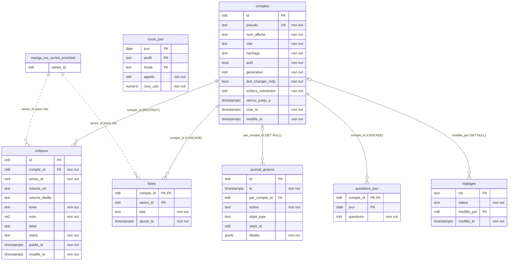

# Modele de donnees — schema `application`

> Genere le 2026-11-11 par `generer_application.py` depuis `schema.json`, extrait de `apimanga` sous le role `verif_lecture` en lecture seule. Rien n'est saisi a la main : tables, colonnes, contraintes, droits et commentaires sont ceux que la base a rendus.

Le schema des donnees de l'application du libraire (module `12_application`) : cree par la migration `027`, complete par la `029` (`questions_jour`, le quota des comptes). Il est separe du catalogue (`manga`) et du corpus (`bench`) : aucune cle etrangere ne les relie, et un seul role y ecrit, `app_rw`.

## Chiffres

| Element | Nombre |
| --- | --- |
| Tables | 7 |
| Colonnes | 46 |
| Cles etrangeres (internes au schema) | 5 |
| Contraintes CHECK | 18 |
| Index (cles comprises) | 10 |
| Liens applicatifs vers le catalogue (sans cle) | 2 |

## Diagramme

Trait plein : cle etrangere reelle ; pointille : lien applicatif, sans cle (l'identifiant du catalogue est valide par l'API de donnees a l'ecriture). `PK` cle primaire, `FK` cle etrangere, `UK` unique.

## Cascades — ce que fait la suppression d'une ligne de `application.comptes`

| Table | Colonne | Vers | A la suppression de la ligne visee |
| --- | --- | --- | --- |
| `critiques` | compte_id | `application.comptes`(id) | RESTRICT (refusee) |
| `journal_actions` | par_compte_id | `application.comptes`(id) | SET NULL |
| `listes` | compte_id | `application.comptes`(id) | CASCADE (suivie) |
| `questions_jour` | compte_id | `application.comptes`(id) | CASCADE (suivie) |
| `reglages` | modifie_par | `application.comptes`(id) | SET NULL |

## Droits par role

| Objet | Type | Proprietaire | Role | Droits |
| --- | --- | --- | --- | --- |
| `application` | schema | `postgres` | `app_rw` | USAGE |
| `comptes` | table | `postgres` | `app_rw` | DELETE, INSERT, SELECT, UPDATE |
| `couts_jour` | table | `postgres` | `app_rw` | INSERT, SELECT, UPDATE |
| `critiques` | table | `postgres` | `app_rw` | INSERT, SELECT, UPDATE |
| `journal_actions` | table | `postgres` | `app_rw` | INSERT, SELECT |
| `listes` | table | `postgres` | `app_rw` | DELETE, INSERT, SELECT, UPDATE |
| `questions_jour` | table | `postgres` | `app_rw` | INSERT, SELECT, UPDATE |
| `reglages` | table | `postgres` | `app_rw` | INSERT, SELECT, UPDATE |

Aucun autre role n'a de droit sur le schema : ni `PUBLIC`, ni les roles de lecture du catalogue et du corpus. Un droit absent est un refus.

## Tables

### `application.comptes`

> Comptes de l'application : pseudo unique, empreinte Argon2id, rôle, état. Aucun courriel. Un compte libraire ne se supprime pas (ses critiques le retiennent).

| Colonne | Type | Null | Defaut | Commentaire |
| --- | --- | --- | --- | --- |
| `id` | int8 | NON |  |  |
| `pseudo` | text | NON |  |  |
| `nom_affiche` | text | NON |  |  |
| `role` | text | NON |  |  |
| `hachage` | text | NON |  |  |
| `actif` | bool | NON | true |  |
| `generation` | int4 | NON | 0 |  |
| `doit_changer_mdp` | bool | NON | false |  |
| `echecs_connexion` | int4 | NON | 0 |  |
| `verrou_jusqu_a` | timestamptz | oui |  |  |
| `cree_le` | timestamptz | NON | now() |  |
| `modifie_le` | timestamptz | NON | now() |  |

- **PK** `comptes_pkey` : `PRIMARY KEY (id)`
- **UNIQUE** `comptes_pseudo_unique` : `UNIQUE (pseudo)`
- **CHECK** `comptes_echecs_positifs` : `CHECK ((echecs_connexion >= 0))`
- **CHECK** `comptes_generation_positive` : `CHECK ((generation >= 0))`
- **CHECK** `comptes_nom_affiche_longueur` : `CHECK (((char_length(nom_affiche) >= 1) AND (char_length(nom_affiche) <= 60)))`
- **CHECK** `comptes_pseudo_forme` : `CHECK ((pseudo ~ '^[a-z0-9_-]{3,30}$'::text))`
- **CHECK** `comptes_role_connu` : `CHECK ((role = ANY (ARRAY['client'::text, 'libraire'::text, 'admin'::text])))`

### `application.couts_jour`

> Coûts estimés du modèle de langage, par jour, profil et mode (cout_estime_usd).

| Colonne | Type | Null | Defaut | Commentaire |
| --- | --- | --- | --- | --- |
| `jour` | date | NON |  |  |
| `profil` | text | NON |  |  |
| `mode` | text | NON |  |  |
| `appels` | int4 | NON | 0 |  |
| `cout_usd` | numeric | NON | 0 |  |

- **PK** `couts_jour_pkey` : `PRIMARY KEY (jour, profil, mode)`
- **CHECK** `couts_appels_positifs` : `CHECK ((appels >= 0))`
- **CHECK** `couts_mode_connu` : `CHECK ((mode = ANY (ARRAY['strict'::text, 'enrichi'::text])))`
- **CHECK** `couts_montant_positif` : `CHECK ((cout_usd >= (0)::numeric))`

### `application.critiques`

> Critiques signées des libraires (série, ou tome par volume_url). Table distincte lue chaque mois par la construction du corpus. Retrait = statut retiree ; aucune suppression physique.

| Colonne | Type | Null | Defaut | Commentaire |
| --- | --- | --- | --- | --- |
| `id` | int8 | NON |  |  |
| `compte_id` | int8 | NON |  |  |
| `series_id` | int4 | NON |  | Identifiant du catalogue (manga.ms_series_enriched.series_id), validé par l'API data du module 02 à l'écriture. Pas de clé étrangère : le schéma application ne dépend pas des instantanés du catalogue. |
| `volume_url` | text | oui |  |  |
| `volume_libelle` | text | oui |  |  |
| `texte` | text | NON |  |  |
| `note` | int2 | NON |  |  |
| `label` | text | oui |  | Code d'une liste fixe, validée par l'application ; la base n'en garde que la forme. |
| `statut` | text | NON | 'publiee'::text |  |
| `publie_le` | timestamptz | NON | now() |  |
| `modifie_le` | timestamptz | NON | now() |  |

- **PK** `critiques_pkey` : `PRIMARY KEY (id)`
- **FK** `critiques_compte_id_fkey` : `FOREIGN KEY (compte_id) REFERENCES application.comptes(id) ON DELETE RESTRICT`
- **CHECK** `critiques_label_forme` : `CHECK ((label ~ '^[a-z_]{1,40}$'::text))`
- **CHECK** `critiques_note_sur_dix` : `CHECK (((note >= 0) AND (note <= 10)))`
- **CHECK** `critiques_statut_connu` : `CHECK ((statut = ANY (ARRAY['publiee'::text, 'retiree'::text])))`
- **CHECK** `critiques_texte_longueur` : `CHECK (((char_length(texte) >= 1) AND (char_length(texte) <= 10000)))`
- **CHECK** `critiques_tome_complet` : `CHECK (((volume_url IS NULL) = (volume_libelle IS NULL)))`
- **index** *(partiel)* `critiques_publiees_par_serie` : `CREATE INDEX critiques_publiees_par_serie ON application.critiques USING btree (series_id) WHERE (statut = 'publiee'::text)`
- **UNIQUE** *(partiel)* `critiques_une_publiee` : `CREATE UNIQUE INDEX critiques_une_publiee ON application.critiques USING btree (compte_id, series_id, COALESCE(volume_url, ''::text)) WHERE (statut = 'publiee'::text)`

### `application.journal_actions`

> Journal des actions, en ajout seul (droits de app_rw : SELECT, INSERT). Jamais de texte libre ni de secret dans details : identifiants et codes seulement.

| Colonne | Type | Null | Defaut | Commentaire |
| --- | --- | --- | --- | --- |
| `id` | int8 | NON |  |  |
| `le` | timestamptz | NON | now() |  |
| `par_compte_id` | int8 | oui |  |  |
| `action` | text | NON |  |  |
| `objet_type` | text | oui |  |  |
| `objet_id` | int8 | oui |  |  |
| `details` | jsonb | NON | '{}'::jsonb |  |

- **PK** `journal_actions_pkey` : `PRIMARY KEY (id)`
- **FK** `journal_actions_par_compte_id_fkey` : `FOREIGN KEY (par_compte_id) REFERENCES application.comptes(id) ON DELETE SET NULL`
- **CHECK** `journal_action_connue` : `CHECK ((action = ANY (ARRAY['compte_cree'::text, 'compte_desactive'::text, 'compte_reactive'::text, 'compte_supprime'::text, 'mot_de_passe_change'::text, 'critique_publiee'::text, 'critique_modifiee'::text, 'critique_retiree'::text, 'profil_actif_change'::text])))`
- **CHECK** `journal_details_objet` : `CHECK ((jsonb_typeof(details) = 'object'::text))`

### `application.listes`

> Listes d'un compte : favori, à lire, à commander. series_id : identifiant du catalogue, sans clé étrangère (voir critiques.series_id).

| Colonne | Type | Null | Defaut | Commentaire |
| --- | --- | --- | --- | --- |
| `compte_id` | int8 | NON |  |  |
| `series_id` | int4 | NON |  |  |
| `etat` | text | NON |  |  |
| `ajoute_le` | timestamptz | NON | now() |  |

- **PK** `listes_pkey` : `PRIMARY KEY (compte_id, series_id)`
- **FK** `listes_compte_id_fkey` : `FOREIGN KEY (compte_id) REFERENCES application.comptes(id) ON DELETE CASCADE`
- **CHECK** `listes_etat_connu` : `CHECK ((etat = ANY (ARRAY['favori'::text, 'a_lire'::text, 'a_commander'::text])))`

### `application.questions_jour`

> Questions posées au conseiller par compte et par jour civil UTC ; porte le quota des comptes clients. Aucun texte : un compteur.

| Colonne | Type | Null | Defaut | Commentaire |
| --- | --- | --- | --- | --- |
| `compte_id` | int8 | NON |  |  |
| `jour` | date | NON |  |  |
| `questions` | int4 | NON | 0 |  |

- **PK** `questions_jour_pkey` : `PRIMARY KEY (compte_id, jour)`
- **FK** `questions_jour_compte_id_fkey` : `FOREIGN KEY (compte_id) REFERENCES application.comptes(id) ON DELETE CASCADE`
- **CHECK** `questions_jour_positif` : `CHECK ((questions >= 0))`

### `application.reglages`

> Réglages de l'application changés par un administrateur (clé, valeur, auteur).

| Colonne | Type | Null | Defaut | Commentaire |
| --- | --- | --- | --- | --- |
| `cle` | text | NON |  |  |
| `valeur` | text | NON |  |  |
| `modifie_par` | int8 | oui |  |  |
| `modifie_le` | timestamptz | NON | now() |  |

- **PK** `reglages_pkey` : `PRIMARY KEY (cle)`
- **FK** `reglages_modifie_par_fkey` : `FOREIGN KEY (modifie_par) REFERENCES application.comptes(id) ON DELETE SET NULL`
- **CHECK** `reglages_cle_forme` : `CHECK ((cle ~ '^[a-z_]{1,60}$'::text))`

